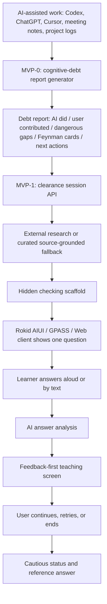
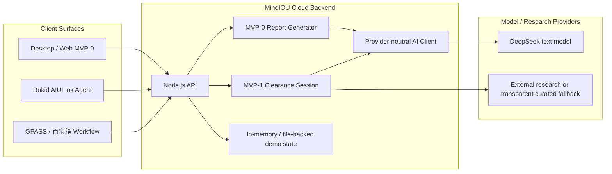

# MindIOU Competition Technical Documentation

Version: 2026-07-15  
Product name: 认知欠条 MindIOU  
Subtitle: 把 AI 代劳转化为真实能力成长

## 1. Technical Goal

MindIOU is an AI cognitive-debt clearance system. It does not try to become a
generic course app. Its first product loop is narrower:

1. A user finishes work with AI assistance.
2. The system analyzes what AI may have skipped for the user.
3. It generates a cognitive-debt report and several Feynman compensation cards.
4. A wearable client asks one large question.
5. The user explains the answer aloud.
6. AI evaluates the user's reasoning, teaches one missing point, asks one
   follow-up, and only settles the card when the user explicitly ends the
   session.

The current competition build demonstrates this loop on Rokid optical-waveguide
glasses and keeps the same backend available for desktop, web, and GPASS /
百宝箱 integration.

## 2. System Workflow



The important design constraint is that the answer scaffold is hidden before the
learner recalls. The glasses should show a question, not a cheat sheet.

## 3. Core Objects

| Object | Purpose | Current status |
| --- | --- | --- |
| Practice input | Raw AI-assisted conversation, AI plan, meeting note, or hackathon log. | Supported by MVP-0 web/backend. |
| Cognitive-debt report | Structured report describing what AI did, what the user contributed, dangerous gaps, layered facts/assumptions/questions/decisions/tradeoffs, Feynman cards, and next actions. | Implemented. |
| Feynman compensation card | One question that asks the user to explain a skipped concept or reasoning gap in their own words. | Implemented. |
| Source-grounded scaffold | Research-backed hidden rubric used by AI to judge the answer. | Implemented for MVP-1. |
| Clearance session | Stateful loop around one card: question, answer attempts, feedback, follow-up, settlement. | Implemented. |
| Cautious status | `provisionally_cleared`, `needs_practice`, `needs_verification`, or `invalid_attempt`. | Implemented. |
| Client surface | Web, Rokid AIUI, and GPASS / 百宝箱 workflow entry. | Web and Rokid implemented; GPASS workflow uses the same API contract. |

## 4. Architecture



### 4.1 Cloud Backend

The backend is shared by all clients:

```text
Production API base:
https://114.67.169.78/mindiou-api
```

Responsibilities:

- Generate MVP-0 cognitive-debt reports from long user input.
- Start and maintain MVP-1 clearance sessions.
- Call the configured text model through provider-neutral settings.
- Keep API keys on the server only.
- Return compact, glasses-safe text to wearable clients.
- Apply conservative settlement rules.
- Provide transparent fallback only for the controlled server-diagnostics demo
  when real external research is unavailable.

Current model configuration:

```text
AI_BASE_URL=https://api.deepseek.com
AI_MODEL=deepseek-v4-flash
```

The model key is stored on the server in an environment file and is not packaged
into the Rokid client, GPASS workflow, or browser bundle.

### 4.2 Rokid AIUI Client

Rokid implementation path:

```text
evenhub-g2-learning/platforms/rokid-aiui/
```

Current package:

```text
release/rokid-craft-project-0.2.12
release/learn-coach-rokid-aiui-0.2.12.zip
SHA-256: 74ccb4fb4ad22e515395c21874a27a599e2330622ad1640a84cd69e3b781a331
```

Key files:

```text
app.js
app.json
config.js
pages/clearance/index.ink
pages/voice-action/index.ink
pages/index/index.ink
pages/import/index.ink
pages/settings/index.ink
utils/api.js
utils/learning.js
```

Responsibilities:

- Load the pinned demo report/card or a report/card passed by launch query.
- Show one question in a bounded `896 x 300` optical-waveguide layout.
- Support Rokid's four practical controls: swipe up, swipe down, click, exit.
- Start `SpeechRecognition` from the immersive Ink page after voice wakeup.
- Submit final ASR text to the MVP-1 session.
- Show AI feedback first; show follow-up only after the user chooses continue.
- Reveal a concise reference answer when the user ends the card.
- Keep page height fixed so swipe navigation does not scroll the canvas.

Current accepted interaction model:

```text
Swipe up/down -> move focused action
Click         -> run focused action
Exit          -> return to previous Rokid view
Voice         -> answer the visible question
```

### 4.3 GPASS / 百宝箱 Workflow

百宝箱 is treated as a workflow shell, not a second implementation of MindIOU
logic. The recommended design is:

```text
User voice/text
  -> GPASS workflow routing
  -> HTTP request to MindIOU API
  -> JSON deserialize
  -> short glasses-safe output
```

The workflow should keep only lightweight variables:

```text
sessionId
question
feedback
teaching
nextQuestion
status
recommendation
```

The full business logic, source policy, scoring, and AI prompt stay in the
MindIOU backend.

## 5. API Contract Used By Wearable Clients

### 5.1 Health Check

```http
GET https://114.67.169.78/mindiou-api/health?live=1
```

Expected use:

- Check whether the server is reachable from the phone or glasses network.
- Confirm whether model service is configured.

### 5.2 Start Clearance Session

```http
POST https://114.67.169.78/mindiou-api/api/mvp1/sessions
Content-Type: application/json
Accept: application/json

{
  "reportId": "c18ecc67-6725-4b60-bc0a-a73e53150d5e",
  "cardId": "card-2",
  "client": "rokid-aiui"
}
```

Important returned fields:

```text
$.session.id
$.session.clearanceQuestion
$.session.sources
$.session.status
```

For GPASS JSON deserialize nodes, `sources` is an array. If the platform field
type is Object, do not map `$.session.sources` directly. Either remove it or map
specific text fields such as `$.session.sources[0].title`.

### 5.3 Submit Answer

```http
POST https://114.67.169.78/mindiou-api/api/mvp1/sessions/{sessionId}/answers
Content-Type: application/json
Accept: application/json

{
  "answer": "我认为 D 状态说明进程在不可中断 I/O 中等待，重启 Nginx 只能重启服务进程，不能直接修复磁盘、网络文件系统或内核层等待。"
}
```

Important returned fields:

```text
$.analysis.feedback
$.analysis.teaching
$.analysis.nextQuestion
$.analysis.status
$.analysis.recommendation
```

### 5.4 End Session

```http
POST https://114.67.169.78/mindiou-api/api/mvp1/sessions/{sessionId}/end
Content-Type: application/json
Accept: application/json

{}
```

Expected output:

- Final cautious status.
- Concise reference answer or teaching summary.
- Recommendation for whether the card is cleared, needs practice, or needs
  verification.

## 6. GPASS / 百宝箱 Node Configuration

### 6.1 Start Session HTTP Node

Method:

```text
POST
```

URL:

```text
https://114.67.169.78/mindiou-api/api/mvp1/sessions
```

Headers:

```text
Content-Type: application/json
Accept: application/json
```

Body:

```json
{
  "reportId": "c18ecc67-6725-4b60-bc0a-a73e53150d5e",
  "cardId": "card-2",
  "client": "gpass-tbox"
}
```

Timeout:

```text
30 seconds
```

Retry:

```text
1 retry, 1000 ms interval
```

### 6.2 Start Session JSON Deserialize Node

Input:

```text
HTTP请求/body
```

Recommended output fields:

| Name | Path | Type |
| --- | --- | --- |
| `sessionId` | `$.session.id` | Text |
| `question` | `$.session.clearanceQuestion` | Text |
| `sourceCount` | `$.session.sources.length` | Number, if supported |
| `firstSourceTitle` | `$.session.sources[0].title` | Text, optional |

Do not define `sources` as Object if the platform reports the actual value as
Array. That mismatch causes the error: output type and node definition type are
inconsistent.

### 6.3 Prompt Output After Start

```text
{{question}}

请直接用自己的话回答。
```

### 6.4 Submit Answer HTTP Node

Method:

```text
POST
```

URL:

```text
https://114.67.169.78/mindiou-api/api/mvp1/sessions/{{sessionId}}/answers
```

Headers:

```text
Content-Type: application/json
Accept: application/json
```

Body:

```json
{
  "answer": "{{userInput}}",
  "client": "gpass-tbox"
}
```

### 6.5 Answer JSON Deserialize Node

Recommended output fields:

| Name | Path | Type |
| --- | --- | --- |
| `feedback` | `$.analysis.feedback` | Text |
| `teaching` | `$.analysis.teaching` | Text |
| `nextQuestion` | `$.analysis.nextQuestion` | Text |
| `status` | `$.analysis.status` | Text |
| `recommendation` | `$.analysis.recommendation` | Text |

Recommended glasses output:

```text
反馈：{{feedback}}

补充：{{teaching}}

继续时回答：{{nextQuestion}}
```

### 6.6 End Session HTTP Node

Method:

```text
POST
```

URL:

```text
https://114.67.169.78/mindiou-api/api/mvp1/sessions/{{sessionId}}/end
```

Body:

```json
{}
```

Recommended final output:

```text
本次状态：{{status}}

参考答案：{{teaching}}

下一步：{{recommendation}}
```

## 7. AI Prompting And Settlement Policy

The AI behavior is designed around Feynman learning:

- Ask the learner to explain in their own words.
- Do not show the answer before recall.
- Evaluate concrete reasoning, not confidence.
- Affirm correct parts first.
- Point out missing or confused parts.
- Teach one compact missing point.
- Ask one follow-up when useful.
- End with cautious status instead of permanent certification.

Settlement rules:

- `provisionally_cleared`: the answer explains the core concept and gives a
  plausible verification or transfer example.
- `needs_practice`: the answer contains a useful fragment but misses core
  reasoning.
- `needs_verification`: the answer is plausible, but source quality or system
  state requires external verification.
- `invalid_attempt`: the answer is empty, irrelevant, or too short to evaluate.

## 8. Security And Privacy

- Model API keys are backend-only.
- Rokid AIUI and GPASS clients contain no API key.
- Public clients call only the MindIOU HTTPS API.
- The competition package is pinned to a demo report/card and does not enumerate
  anonymous visitor reports.
- The current demo uses a short-term IP HTTPS certificate for the server. For
  long-term production, the service should move to a stable domain and named
  certificate.

## 9. Validation Status

Current verified build:

```text
Rokid AIUI package: 0.2.12
Backend API: https://114.67.169.78/mindiou-api
Demo report: c18ecc67-6725-4b60-bc0a-a73e53150d5e
Demo card: card-2
```

Last verified checks:

```text
platforms/rokid-aiui: npm run check
platforms/rokid-aiui: npm test
platforms/rokid-aiui: npm run build:ink-preview
platforms/rokid-aiui: npm run pack
root project: npm test
root project: npm run build
```

Observed acceptance:

- Real Ink preview loads the `.ink` bundle.
- The 896 x 300 layout stays bounded.
- Binding warnings for `phase` and `pendingQuestion` are removed in 0.2.12.
- ASR-shaped debug events submit to `/answers`.
- AI feedback appears before follow-up.
- End action reveals a concise reference answer.
- Next-card transition no longer flashes previous large feedback text.

Remaining hardware validation:

- Import `release/rokid-craft-project-0.2.12` into Rokid Craft.
- Bind the agent in the competition account.
- Generate `.aix`.
- Verify physical microphone wakeup, final ASR transcript, four-control
  navigation, and exit behavior on the target Rokid glasses firmware.

## 10. Known Boundaries

- OpenAI is not required for the current demo. DeepSeek text generation is the
  active configured provider.
- Real-time external web research is not available for every arbitrary card in
  the demo environment. The server-diagnostics demo card uses a transparent,
  source-cited fallback and therefore can settle at most cautiously.
- GPASS / 百宝箱 is best implemented as a workflow wrapper around MindIOU API
  rather than a duplicate business system.
- The current version is a competition MVP, not a full learning platform,
  credentialing product, or unattended production assessment system.
