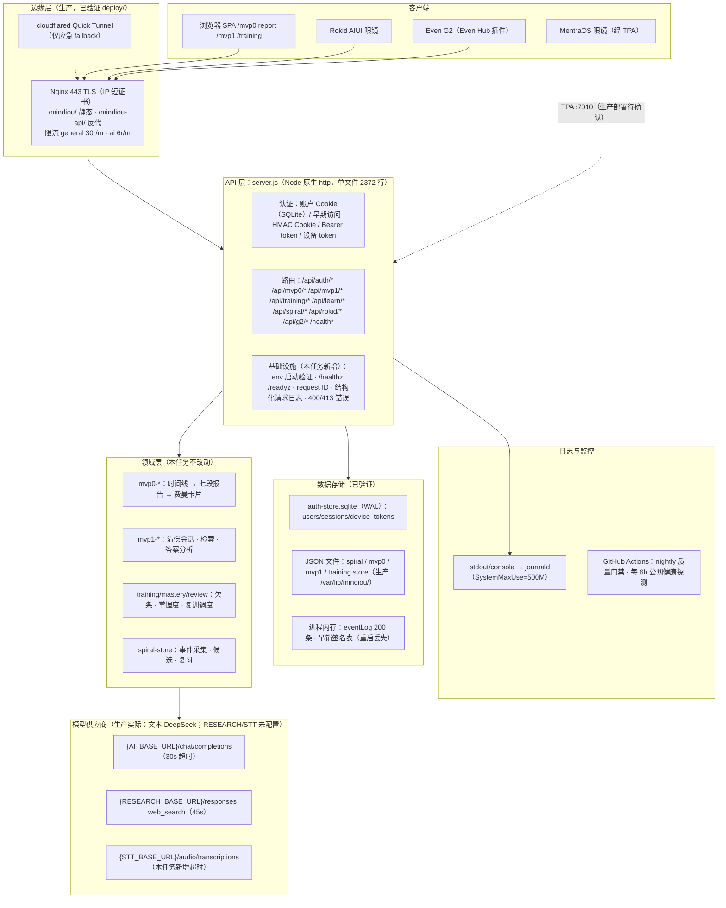

# MindIOU 后端架构（2026-07-30 核验版）

本文基于 `refactor/backend-ops-boundaries` 分支代码核验编写。标记：已验证 / 推断 / 待确认。

## 1. 分层视图

## 2. 各层职责

| 层 | 职责 | 明确不做 |
|---|---|---|
| 客户端 | 渲染、输入、设备交互约束 | 不持有密钥；不做评分 |
| Nginx | TLS 终止、静态服务、按路由反代、限流、请求体上限、公网屏蔽清单 | 不做业务鉴权（仅 3 个硬屏蔽路由） |
| server.js | 路由、认证授权、请求解析、调用领域逻辑、调用模型、持久化 | 不直接含领域算法（在独立模块） |
| 领域模块 | 报告生成、清偿会话、训练调度、卡片质量 | 不做 HTTP、不读环境变量（由 server.js 注入） |
| 模型供应商 | 文本生成 / 联网检索 / 语音转写 | 不做持久化 |
| 存储 | SQLite（认证）+ JSON 文件（业务）+ 内存（瞬态） | 无备份、无迁移工具（债务） |

## 3. 当前混乱点（核验事实，按严重度排序）

1. **API 层单文件巨石**：`server.js` 2372 行，路由、认证、模型客户端、fallback 逻辑、WAV 编码混在一起。可维护性差，但本次只做低风险整理，分阶段重构计划见 BACKEND_DEBT_BACKLOG。
2. **配置无启动验证**（本任务修复前）：密钥缺失/弱密钥只在请求时才暴露（如早期访问登录返回 503）。本任务新增 `env-validation.js` 启动校验。
3. **端口事实不明**：代码默认 8793，Nginx 反代 8794，依赖仓库外的 `/etc/mindiou.env` 桥接——新人无法在仓库内确定生产端口（已在文档标注推断）。
4. **死配置**：Nginx 反代 `/api/admin/*`，但 `admin-backend-patch.js` 未挂载（根目录与 web/ 各有一份重复补丁文件）。
5. **两套会话并存**：账户体系 `session` Cookie（SQLite）与早期访问 `mindiou_session` HMAC Cookie（内存吊销表）并行，`requireAuth` 做了兼容回退。属过渡态，已记录。
6. **健康检查单薄**：只有一个 `/health`，无 liveness/readiness 区分；`?live=1` 是唯一的依赖探活且会真实出站。本任务新增分层端点。
7. **可观察性缺失**（本任务修复前）：无 request ID、无结构化日志、无请求耗时；错误只有 `console.warn`；500 直接回显 `error.message`。本任务新增低风险基础设施。
8. **训练路由匿名可写**：`/api/training/*` 用 `getOptionalUser`，匿名请求落到 `demo-user` 命名空间（已验证为有意的演示设计，但公网上任何人可写 demo-user 数据）。记录为风险而非缺陷。
9. **JSON 文件存储**：四份业务数据为单文件 JSON，无锁、无备份、无原子写保证（`training-store` 等自实现 save）。演示规模可用，规模化是债务。
10. **模型调用无护栏**：无并发限制、无重试策略、无幂等键；重复 POST 报告生成会重复计费（Nginx ai 档 6r/m 是唯一防线）。STT 调用本任务修复前无超时。

## 4. 边界原则（本任务遵守）

- 客户端密钥为零：所有供应商密钥只在 server.js 进程内（`/etc/mindiou.env`），前端包不含任何密钥（`production-health.yml` 有 localhost 检查，无密钥检查——记入债务）。
- 旧 API 路径与字段不变；新增仅为可选字段与新路径（`/healthz`、`/readyz`）。
- 领域逻辑（mvp0/mvp1/training/mastery/review/spiral）不在本任务修改范围。
